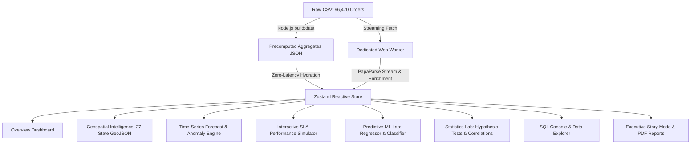

# AI-Powered Delivery Time Estimation & Smart Promise Platform

> **AI For Business Analytics (5th Semester) — Project**  
> **Institution**: Dayananda Sagar University (DSU)  
> **Dataset**: Brazilian E-Commerce Delivery Dataset by Olist (96,470 orders, 2017–2018)  
> **Design Theme**: Light & Dark Glassmorphism with Smooth Dynamic Animations

---

## 🚀 Quick Start Terminal Commands

Run these terminal commands from the project root:

### 1. Install Dependencies
```bash
npm install
```

### 2. Precompute Data Aggregates
Recompute JSON summary aggregates from the raw 96,470 CSV rows into `/public/data/aggregates/`:
```bash
npm run build:data
```

### 3. Start Development Server
Launches the Vite development server with Hot Module Replacement (HMR):
```bash
npm run dev
```
> Server runs live at: **`http://localhost:5173/`**

### 4. Run Unit Tests (Vitest)
Executes test suites for currency conversions, dual-time math, analytics formulas, and ML metrics:
```bash
npm test
```

### 5. Production TypeScript Build
Type-checks with strict TypeScript compiler and compiles the minified production bundle:
```bash
npm run build
```

### 6. Preview Production Build
Locally preview the built production bundle:
```bash
npm run preview
```

---

## 🌟 Core Architecture & Features



### Key Capabilities
1. **Title**: **Delivery Time Tracking**
2. **Dual Currency**: Displays **US Dollars first with Indian Rupees in brackets** (`$ USD (₹ INR)`), e.g. `$214,166 (₹1.77 Cr)`.
3. **Dual Time**: Order timestamps show both **Brazilian Standard Time (BRT / UTC-3)** and **Indian Standard Time (IST / UTC+5:30)** (`10:56 BRT • 🇮🇳 19:26 IST`).
4. **Full Brazilian State Names**: Everywhere (dropdowns, chips, routes, tables, drawers), e.g. `São Paulo (SP) → Rio de Janeiro (RJ)`.
5. **Interactive SLA Simulator**: Multi-slider model adjusting latency ceiling, SLA on-time compliance target, and state remediation lifts in real-time.
6. **24-Hour Diurnal Velocity Curve**: Natural area spline with interactive day selector filters.
7. **Client-Side ML**: Delivery duration regressor, late delivery classifier with confusion matrix, and what-if simulator.
8. **Client-Side SQL**: In-browser query engine with automated visual chart generation.
9. **Zero Lag & Glassmorphism**: Tailored light and dark modes with silky transitions and optimized canvas background.
